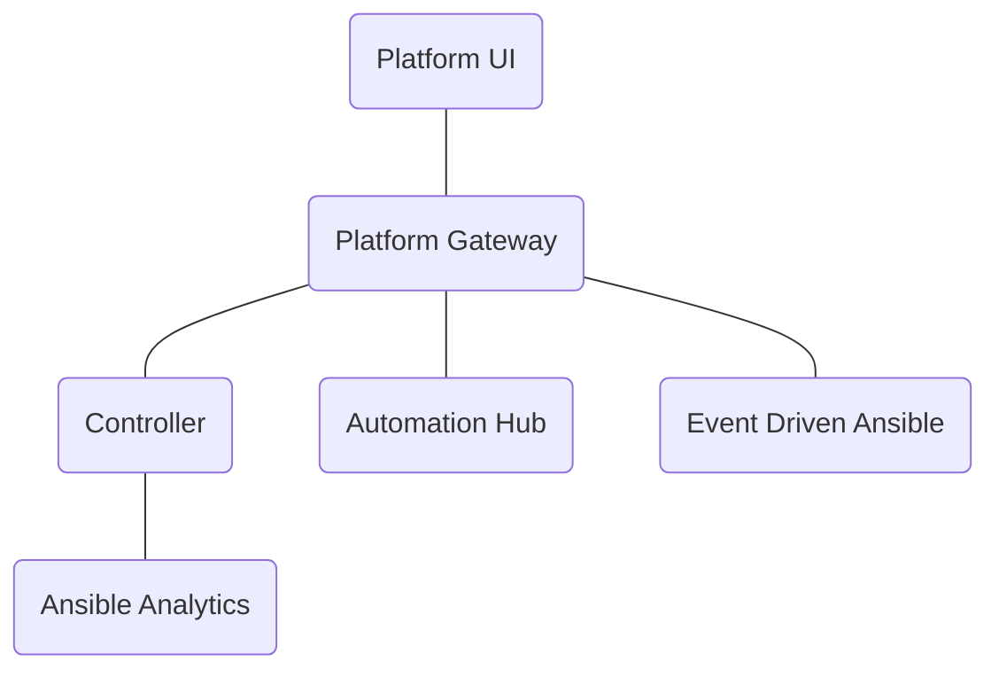

# Platform UI architecture

The Platform UI in [`platform/`](../../platform/) is the unified web UI for Ansible Automation Platform.

- Dynamically composes navigation and pages for a single product experience.
- Embeds UI from the Controller (AWX), Hub, EDA, and Analytics workspaces under `frontend/`.
- Includes gateway-specific areas such as dashboard, authentication, access management, and settings.

The [Ansible platform gateway](https://github.com/ansible/aap-gateway) is the supported backend:

- Unifies APIs for Controller, Hub, EDA, and related services.
- Provides centralized authentication and access management.

Local development runs the Vite dev server in `platform/` and points at a gateway using the `PLATFORM_SERVER` environment variable. See the [repository README](../../README.md) and [`platform/README.md`](../../platform/README.md).
