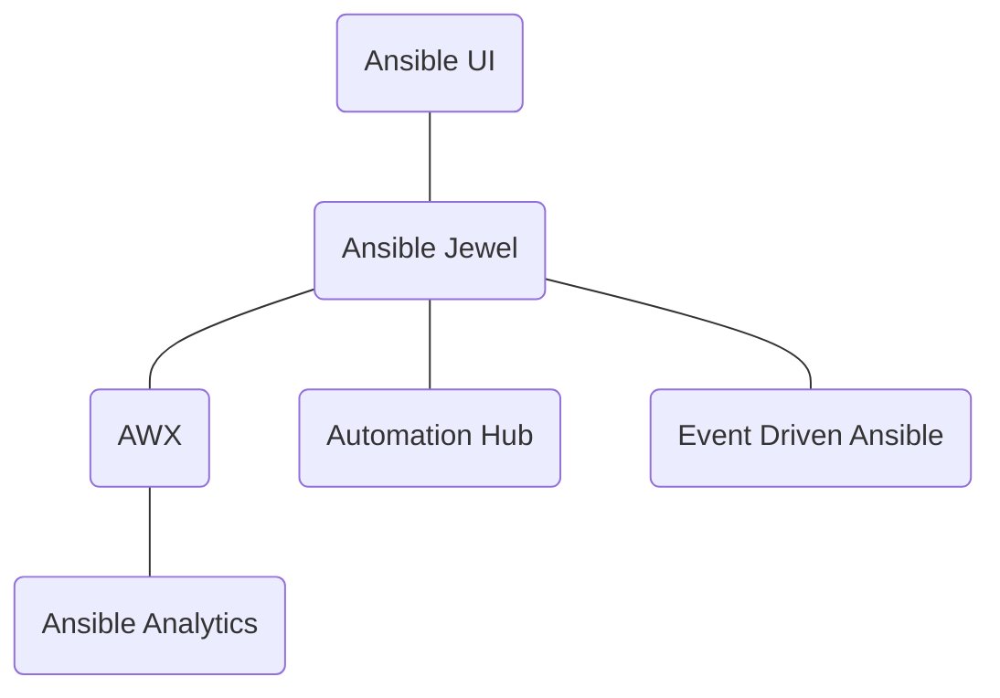

# Ansible UI architecture

The application in [`platform/`](../../platform/) is the unified web UI for Ansible.

- Dynamically composes navigation and pages for a single product experience.
- Embeds UI from the AWX, Hub, EDA, and Analytics workspaces under `frontend/`.
- Includes Jewel-specific areas such as dashboard, authentication, access management, and settings.

[Ansible Jewel](https://github.com/ansible/jewel) is the supported upstream backend:

- Unifies APIs for AWX, Hub, EDA, and related services.
- Provides centralized authentication and access management.

Local development runs the Vite dev server in `platform/` and points at Jewel using the `PLATFORM_SERVER` environment variable. See the [repository README](../../README.md) and [`platform/README.md`](../../platform/README.md).
