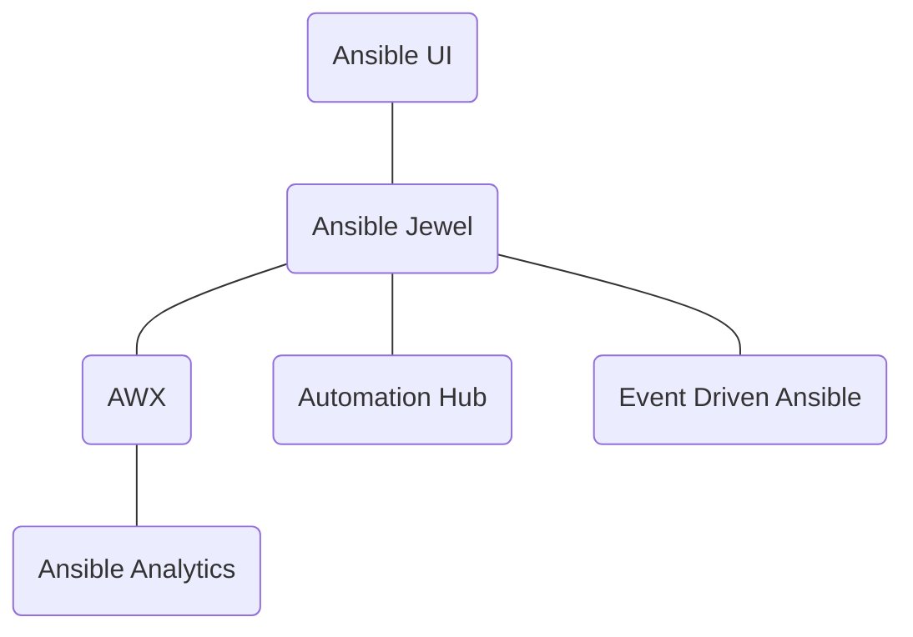

# Platform UI

The **Platform UI** is the application in this directory: the unified Ansible web UI built from the `platform/` workspace. It uses [Ansible Jewel](https://github.com/ansible/jewel) as the API backend. Jewel unifies AWX, Hub, and EDA services and provides centralized authentication and access management.

For prerequisites, environment variables, and the recommended **`npm start` from the repository root** workflow, see the [repository README](../README.md).



## Getting Started

1. Prerequisites

   - [Node.js](https://nodejs.org/) **24.x or newer** (see `engines` in the [root `package.json`](../package.json))
   - npm (bundled with Node)

1. Setup Jewel

   Follow the [Ansible Jewel](https://github.com/ansible/jewel) documentation to run Jewel locally.

1. Clone the Ansible UI Repository

   ```zsh
   git clone git@github.com:ansible/ansible-ui.git
   cd ansible-ui
   ```

1. Install Package Dependencies

   ```zsh
   npm ci
   ```

1. Setup Environment Variables

   | Environment Variable | Description                                  |
   | -------------------: | -------------------------------------------- |
   |    `PLATFORM_SERVER` | The Jewel API server (protocol://host:port). |

   ```zsh
   export PLATFORM_SERVER=https://localhost:443
   ```

1. Run the Platform UI

   From the repository root (recommended):

   ```zsh
   npm start
   ```

   Or from this directory:

   ```zsh
   npm start
   ```

   This starts the dev server on <https://localhost:4100>. The dev server proxies API requests to Jewel using the `PLATFORM_SERVER` environment variable.

## Building for Production

1. Clone the Ansible UI Repository

   ```zsh
   git clone git@github.com:ansible/ansible-ui.git
   cd ansible-ui
   ```

1. Install Package Dependencies

   ```zsh
   npm ci
   ```

1. Build the Platform UI

   ```zsh
   cd platform
   npm run build
   ```

   The built Ansible UI static files should be in the `platform/dist` directory.
   These should be served using a service like `nginx`.
   An example nginx config for optimal client side caching is at `/platform/platform.conf`
